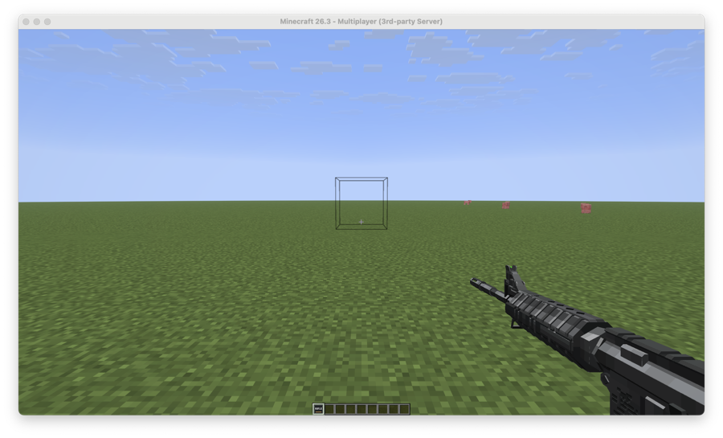
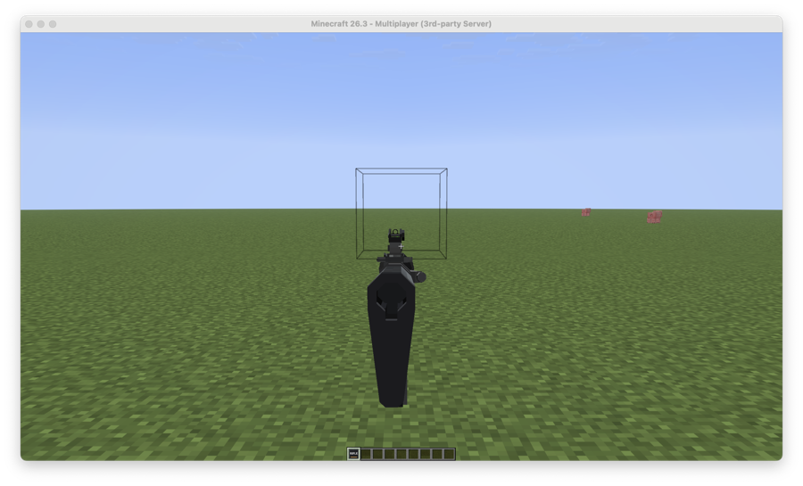
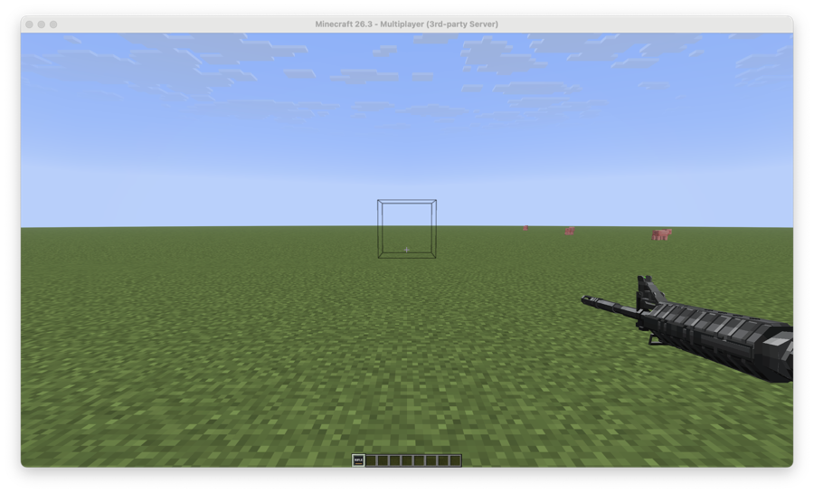

# Viewmodel: why a held item cannot be moved per player, and how Firearms does it

## What was actually wrong (found on a real 26.3 client, 0.30)

Three bugs stacked, so nothing could be seen before 0.30; each alone would have hidden the gun:

1. **The pack never loaded.** The generated `pack.mcmeta` declared format 46; a 26.3 client refuses such a pack
   outright ("Error reading pack metadata... require a supported_formats field") and applies nothing of it. The
   client log says so, the server cannot know. Now `min_format` is 97 (never below 65).
2. **Every rig part was spawned at world 0,0,0.** The AddEntity packet was built with the constructor that takes a
   BlockPos, and that constructor uses the BlockPos as the position (it is for paintings). Now the explicit one.
3. **The display frame was mirrored.** A CENTER-billboarded display's local axes are plain view space (+X right,
   +Y up, +Z toward the camera); the rig assumed +Z forward / +X left, so the gun was placed behind the head.
   Measured with a test entity: offset (0.6, -0.2, -1.0) shows up right, slightly low, one block ahead.

Verified with screenshots on a real client (0.30 defaults, the TaCZ M4 rifle model):

| hip | aiming (`/firearms aim`) | `/viewmodel 3 1 0` |
| --- | --- | --- |
|  |  |  |

Also seen working: the fire clip with the muzzle flash, and the blend H to A and back.

## The short version

A Minecraft **item in the hand** is placed by the item model's `display.firstperson_righthand` transform, which
lives in the resource pack. The pack is the same file for every player and the server has no packet that says
"draw this player's held item somewhere else". So with conventional items a viewmodel offset can only be changed
for everybody at once, by rebuilding the pack (`/firearms pose`). Per player it is impossible with items.

The theory in the report is right: it has to be **entities**. Since 0.25 (default since 0.27) the first-person
gun is a rig of `item_display` entities that exist only in packets sent to that one player: one entity per
animated part, riding the player (passenger packet) so it follows the camera position every frame, billboarded
`CENTER` so it follows the camera rotation, and given a transformation the server computes from the gun's
first-person pose plus that player's `/viewmodel` offset. The entity's transformation is per entity, and the
entities are per player, so the offset is per player. Core shaders could also do it in principle, but a shader
has no per-player input (the pack is shared), so it would need a signal baked into item data; 0.27 tried that
route for recoil, it broke pack loading, and it is gone.

## Aiming uses the same entities

The rig also does the aim: your hip pose H (with your offset) blends to a fixed aim pose A shared by everyone and
back, interpolated by the client (`display.rig.aim-ticks`). A is tuned live with `/firearms pose <gun> aim ...`;
see FIREARMS.md *Aiming on the rig*.

## What each `/firearms rig` line means

1. **server can build rigs** - the plugin found the server's `item_display` classes (26.3 moved them to
   `EntityTypes`; 0.25/0.26 failed here silently, fixed in 0.27). NO = nothing below can work; send the message.
2. **poses loaded** - `/firearms pack` writes `models/poses.bin` with every part's pose per tick of every clip.
   Empty = the pack was never built on this plugin version, or the guns were built in frame mode.
3. **the held gun's mode** - `anim.mode: display` (config, default since 0.27) or per gun `anim: { mode: display }`.
   A frame-mode gun has its first person baked into the pack and `/viewmodel` cannot touch it.
4. **rig showing for you** - the entities were sent to your client. If this says YES and you see no gun, the
   client did not apply the pack (the part items render as nothing because their models are missing), or the
   rig sits out of view (try `/viewmodel 0 0 0` and look around; a placement bug is a `display.rig.*` tuning job).
5. **pack** - the delivery status and the URL your client was told to download; "declined"/"failed" there is the
   whole explanation. 0.27's pack carried a core shader that 26.3 clients rejected, which made the entire pack
   fail to apply: no guns, no rig, no flash. 0.28 has no shaders at all.
6. **your offset** - what `/viewmodel` stored for you.

## Testing from the console (no client input needed)

- `/viewmodel <player> <right> <up> <forward> | reset | show` (admins / console) sets another player's offset.
- `/firearms aim <player> on|off` holds or releases the sight for a player; `/firearms fire <player>` fires one shot.
- `display.rig.debug: true` logs the first parts' transforms every time a rig is (re)sent; `static-test: true`
  parks the parts two blocks ahead without riding, to tell "entities do not appear" from "placed wrong".

## Checklist when "viewmodel does nothing"

- Only one Firearms jar in `plugins/`, console shows `Enabling Firearms v0.30.0` or newer, and `/firearms pack` was run on it (older packs are rejected by the client).
- `/firearms rig` lines 1-4 green with a gun in hand.
- The client accepted the pack: the chat shows the server's pack prompt, and `/firearms host` shows no failure
  for you. A client with the pack declined shows a plain crossbow in third person and nothing in first person.
- `/viewmodel 5 0 0` then `/viewmodel -5 0 0`: the rig moves a third of a block right and left at once, no rejoin.
- Still nothing: send the six lines of `/firearms rig` and a screenshot with the pack prompt visible.
